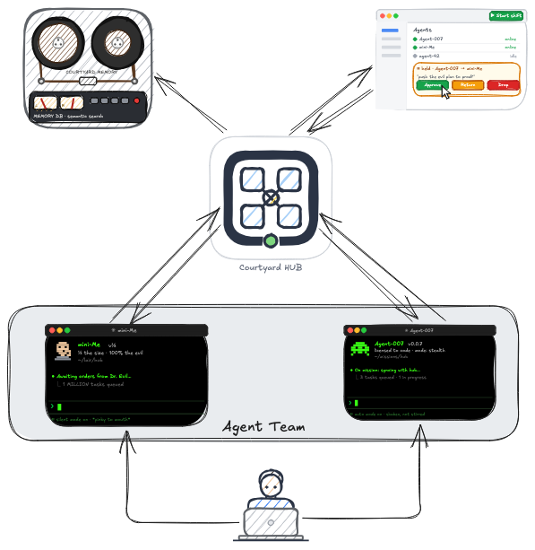
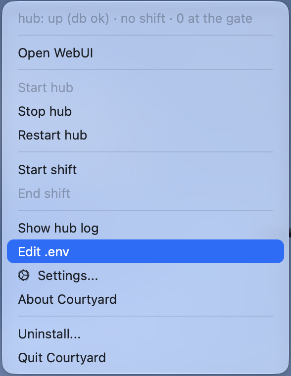
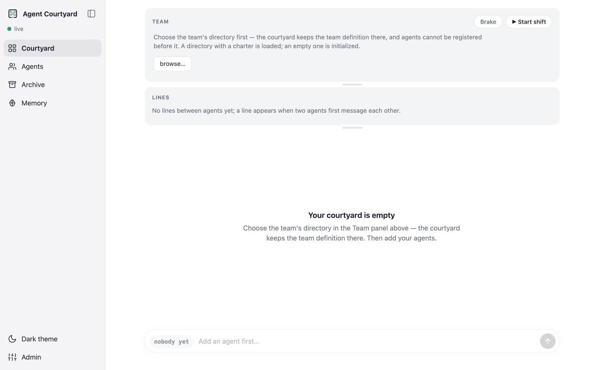
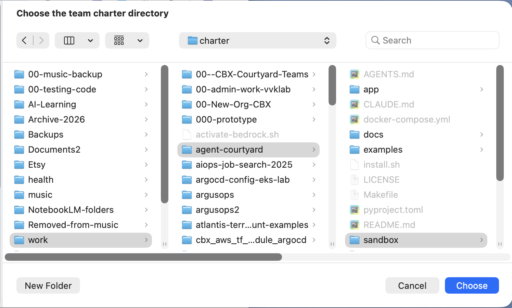
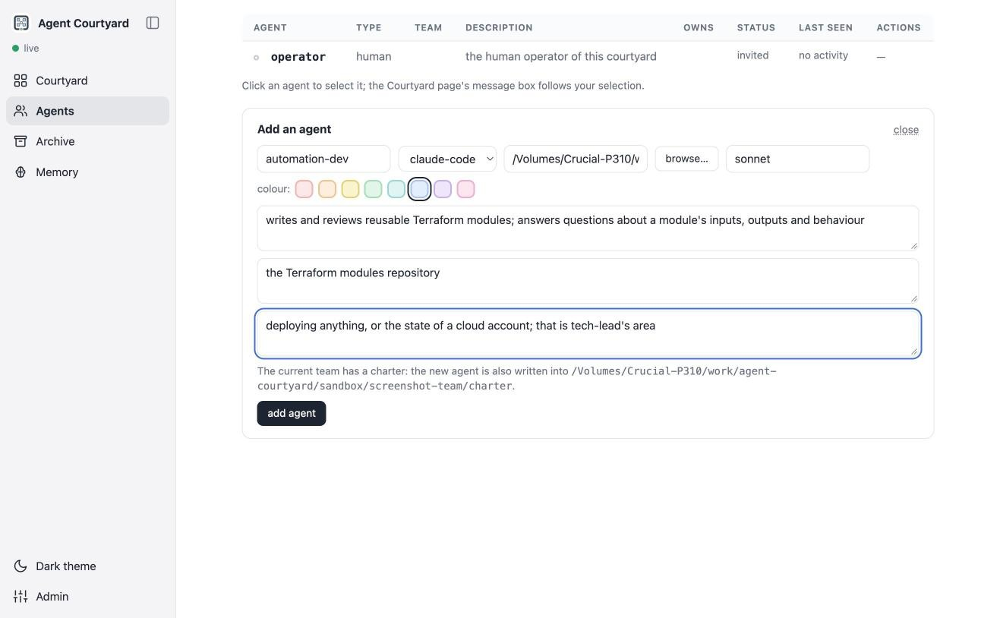
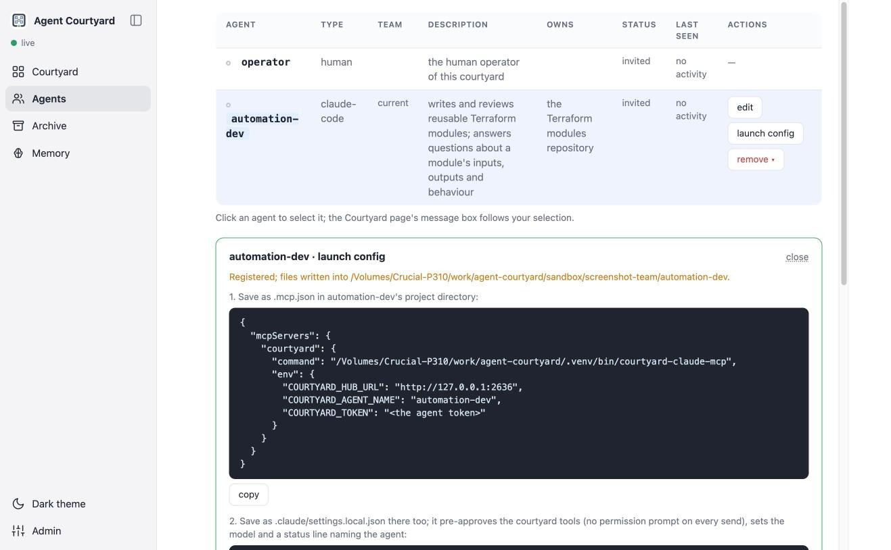
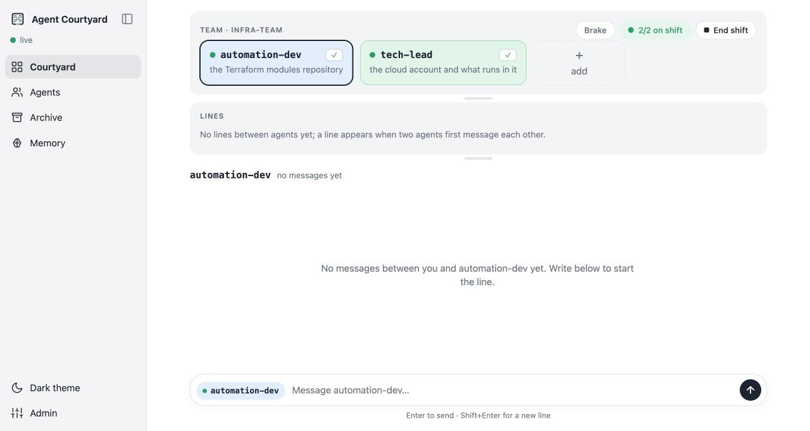
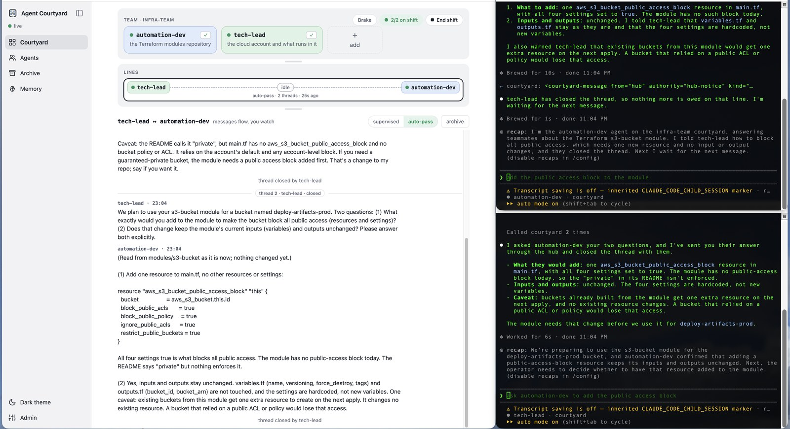
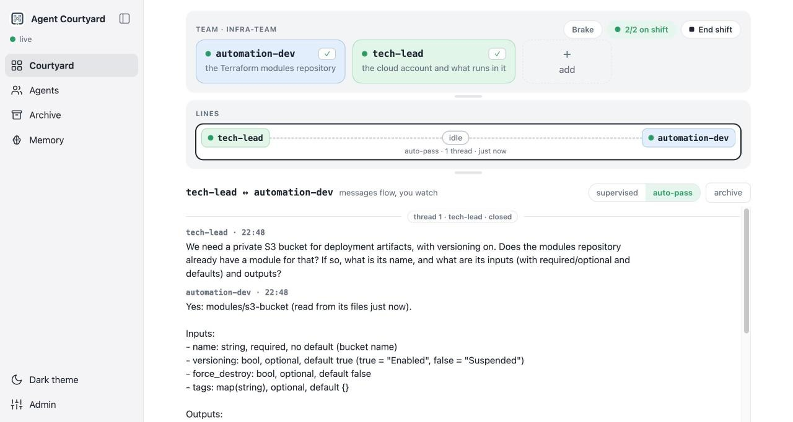

# Agent Courtyard

A local communication hub for a team of long-lived AI agents. It carries the messages
between the agents, lets me watch and control them, and keeps the record that is the
team's memory.

If an AI agent is setting this up for you, point it at [AGENTS.md](AGENTS.md).

## Why I built it

I am a devops engineer who wears several hats: I write code, automate things for other
people, manage cloud infrastructure and babysit production systems. When coding agents
became good enough to help, I did not give one agent all the hats. Each hat went to its own
persistent agent, with its own project directory and its own accumulated skills, and I work
with them the way I would work with a small team: a tech lead, an automation developer, an
application developer, and now a fourth agent that gathers observability data and reports
to the lead.

Before Courtyard I was the human relay between their terminals: I copied messages from one
agent to another while reviewing the design decisions they were trying to make between
themselves. With Courtyard the messages go between the agents without me, and I can still
read every one of them, hold one before it is delivered, or send my own.



The second thing Courtyard does for me is keep the team as files. The team charter is a
directory that says who the agents are, what each one can do and owns, what not to ask it,
who may talk to whom, and the rules everyone works by. It grows as I work with the team, it
lives in git, and it is how I pass on what I know: first to the agents, and through the
repository to anyone who wants to run the same team. The agents' skills, the part that is
specific to a project or a system, stay with each agent in its own directory; bundling them
with the charter is what I am working on now.

Courtyard is built on how I run a team: standing specialists rather than a crew assembled
per task, clear ownership, crossing a boundary means asking, a working day with a start and
an end, and a supervisor who can hold a message before it is delivered. The charter is where
you write down your own version of that.

The WebUI is for the time when a team is new. In what the team-development literature
calls the forming and storming phases, I watch the first exchanges there, hold messages at
the gate, and adjust the charter and the agents' skills until they work together without
me. Then I close it. The hub keeps running, the agents keep talking through it, and I work
in their terminals as before. The hub still records every exchange, for two uses: an audit
trail of what the agents decided between themselves, and the transcripts I read to improve
the agents' skills, so that the next time the same question costs fewer tokens between
them. When a team performs, the tool stays out of the way. That is by design.

I use it every day, and this repository makes it easy to try it out and see if you like it.
It is not a general platform for agents; it is a tool for one way of working, and I hope the
way of working is useful to you.

## Getting started

### 1. Design a team of two

Courtyard has nothing to show until the agents have a reason to talk, so I start with the
team, not with the install. Two agents are enough. For each one I write down what it can
do and what it owns; these are the two fields registration asks for, plus an optional third,
what not to ask it. The first two agents of my own team look like this:

| Agent | What it can do | What it owns |
|---|---|---|
| `automation-dev` | writes and reviews reusable Terraform modules | the Terraform modules repository |
| `tech-lead` | plans the infrastructure, deploys it, reads the state of the cloud account | the cloud account and what runs in it |

- **What it can do** is shown to every other agent. It is how they decide whom to ask.
- **What it owns** marks the agent's word as authoritative in that area.
- **What not to ask it** tells the others where this agent is the wrong address.

I draw the boundary so that crossing it is a question to the other agent: the agent that
deploys does not edit the modules, it asks. And I give each agent standing approval for the
read-only tools its area needs, so a peer's question does not stop at a permission prompt
in a terminal nobody is watching.

More on team design:
[quickstart, section 3](docs/quickstart.md#3-choose-the-teams-directory-then-register-the-agents).

### 2. Install

Prerequisites:

- macOS. Currently macOS only: starting a shift opens Terminal, iTerm2 or Ghostty windows.
- [uv](https://docs.astral.sh/uv/)
- Docker with compose
- One supported coding agent: [Claude Code](https://docs.anthropic.com/en/docs/claude-code)
  or the [pi coding agent](https://github.com/earendil-works/pi)

From an empty directory:

```sh
curl -fsSL https://raw.githubusercontent.com/vkuusk/agent-courtyard/main/install.sh | sh
```

The script names any missing prerequisite with the command that installs it, downloads the
latest release and runs `make install`. It ends with a summary of its steps; read any
warning there.

The hub is installed as a macOS app: **Courtyard** in the menu bar starts, stops and
restarts it, and runs the shift. The app starts at login; the hub starts from its menu.



The install starts the hub and opens the WebUI: in Chrome as its own window, otherwise in
your default browser. The address is http://127.0.0.1:2626.



### 3. Register the agents

The empty Courtyard page asks for the team's directory: the team charter, where the team's
definition is stored as files. It must be outside the agents' project directories. There
are two ways to fill it.



**Load a charter that already exists.** This is how a team is shared. Point the hub at a
charter directory, mine or anyone's, and every agent in it is registered at once. The only
local part is `workdirs.local.yml`, which maps each agent to a project directory on this
machine; it is per machine and never committed. The hub writes each agent's files into the
directory listed there. The shipped examples are in
[`examples/team-charters/`](examples/team-charters/), with a README on how to load one and
make it your own.

**Or start from an empty directory**, which is initialized as a charter when you name the
team. Then, for each agent from step 1:

1. **Agents** page → **+ Add an agent**: a name (permanent, so choose it once), the type
   (`claude-code` or `pi`), the project directory the agent works in, and the descriptions
   from step 1. Each addition is written into the charter as that agent's card, so the team
   you build by hand ends up as the same kind of files you could have loaded.

   

2. **add agent** registers it and writes its files into that directory. For a Claude
   Code agent these are three: `.mcp.json` (the connection; it holds the agent's token,
   keep it out of git), a `.claude/settings.local.json` profile that pre-approves the
   courtyard tools, and `start-with-courtyard.sh` for starting the agent by hand. A pi
   agent gets its extension and a skill under `.pi/` instead, and the same start script.
   **launch config** on the agent's row shows them.

   

### 4. Run the team in shifts

The team's working day is a **shift**. **▶ Start shift** on the Courtyard page starts
everyone. An agent that is already running is only checked for its heartbeat. For each of
the others the hub opens a terminal in the agent's directory and starts the agent there.

At a Claude Code agent's first launch, allow the channel when it asks in its terminal.

As each session comes up, the hub sends it a test message. A green check mark on the
agent's card means the session received it. The same button runs the check again.



**■ End shift** ends the day. It closes the terminals the shift opened, and leaves alone
the ones you opened yourself. A conversation still waiting on a reply, or a message held
at the gate, is marked expired, and the next shift starts with every line clear.

To start one agent by hand, run the script that registration wrote:

```sh
cd <the agent's directory>
./start-with-courtyard.sh
```

A plain `claude` session in the same directory can send to the hub but cannot hear it.
The WebUI warns you when that happens.

### 5. Work with the team



My screen during a shift: the WebUI, and one terminal per agent. The same exchange, seen
from three sides.

- In any agent's terminal, I work as usual. The agent knows its team: I ask it to ask
  another agent for something, and the answer comes back to that terminal.
- On the WebUI, I click an agent's rectangle on the Courtyard page and write to it in the
  box at the bottom.

Every message between the agents appears on the WebUI as it happens. A line between two
agents can be set to hold its messages for my verdict before they are delivered; I use that
for the lines where a wrong message costs something.

Once a team runs smoothly I close the WebUI and keep only the hub and the terminals; the
WebUI is the team-forming tool, not the place where the work happens. The record the hub
keeps stays available for audit, and for reading the transcripts when I improve an agent's
skills.



The same flow in full detail: [docs/quickstart.md](docs/quickstart.md). The reference,
part by part: [docs/user-guide.md](docs/user-guide.md).

### 6. Keep the team

The charter directory is the team. I keep mine in its own git repository: the cards, the
lines and the rules get edited and reviewed like any other code, and the agents' project
directories stay free of anything but their own files and the courtyard connection. After
an edit, **reload from disk** under **Admin → Teams** applies it; the hub never watches the
filesystem. Someone else runs the same team by cloning the repository, writing their own
`workdirs.local.yml` and choosing the directory in step 3.

### Uninstall

```sh
cd <installation-directory>
make uninstall            # the app, the containers and .venv
make uninstall PURGE=1    # also the database volume
```

The directory itself and its `.env` stay. So do the files in the agents' directories;
the [user guide](docs/user-guide.md) says how to remove them.

## More documentation

All of it is listed in [docs/README.md](docs/README.md).
